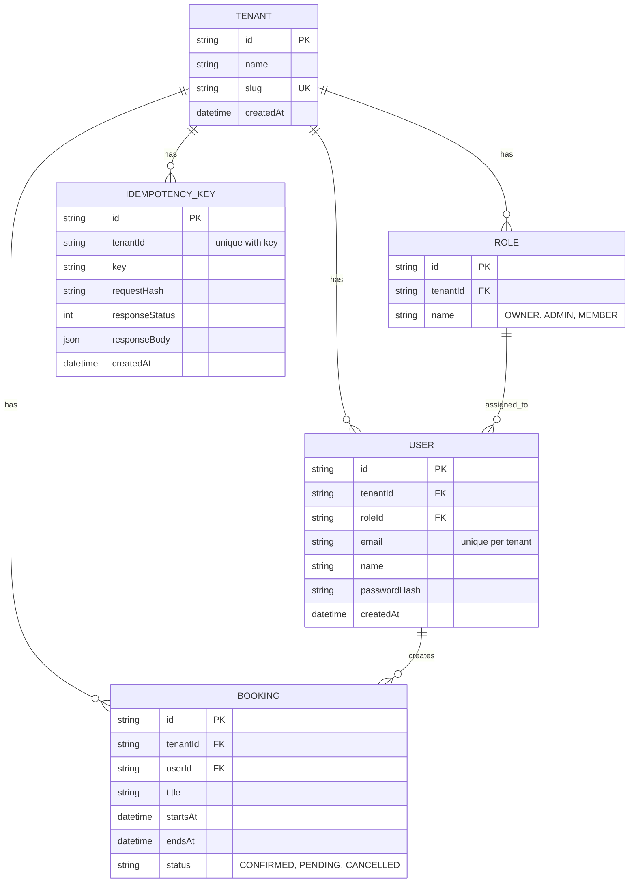
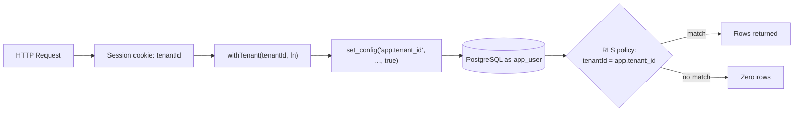

# TenantBook

A multi-tenant booking platform built with Next.js, PostgreSQL and Prisma. Every organization (tenant) gets its own isolated data, enforced at the database level with PostgreSQL Row-Level Security (RLS). Users manage bookings through idempotent REST APIs and a responsive calendar UI.

## What I Built

**Week 1: Foundation**
- Multi-tenant schema (Tenant, Role, User, Booking) with RLS isolation
- Dockerized PostgreSQL with separate `owner` and `app_user` roles
- Zod-validated environment variables
- Seed script with 3 realistic organizations

**Week 2: Booking APIs and UI**
- Session login with signed JWT in an `httpOnly` cookie
- Booking CRUD APIs with strict Zod validation
- **Idempotent `POST /api/bookings`** using an `Idempotency-Key` header
- One standard error response shape for every endpoint
- Role-based permissions (MEMBER edits only their own bookings)
- Calendar and list UI, create/edit form, detail view, delete with confirmation
- Toast notifications, automatic retry for network and 5xx errors, optimistic delete with rollback
- Mobile layout: month grid on desktop, agenda list on small screens
- Postman collection in `docs/`

## Tech Stack

- **Framework:** Next.js (App Router) + TypeScript
- **Styling:** Tailwind CSS
- **Database:** PostgreSQL 16 (Docker)
- **ORM:** Prisma 7 with `@prisma/adapter-pg`
- **Validation:** Zod (API, env vars, forms), React Hook Form
- **Client data:** TanStack React Query, Sonner (toasts), date-fns
- **Auth:** bcrypt password hashing, `jose` for JWT sessions

## Approach and Design Decisions

### 1. Tenant isolation in the database
Isolation is enforced by PostgreSQL RLS, not only by application code. Every request runs inside `withTenant(tenantId, fn)`, which opens a transaction and sets `app.tenant_id` using `set_config(..., true)`. The value is local to that transaction, so it cannot leak between requests. If no tenant is set, queries return zero rows.

Because `Tenant` is also protected by RLS, login uses a `SECURITY DEFINER` function, `resolve_tenant(slug)`, to map an organization slug to its ID before any tenant context exists.

### 2. Idempotent booking creation
`POST /api/bookings` requires an `Idempotency-Key` header (the client generates a UUID once per form submit).

1. The key row is inserted with `ON CONFLICT DO NOTHING` inside the same transaction as the booking.
2. **New key:** the booking is created, the response is stored on the key row, and `201` is returned.
3. **Same key, same body:** the stored response is returned with an `Idempotent-Replayed: true` header and no new booking is created.
4. **Same key, different body:** `422 IDEMPOTENCY_KEY_REUSED`.

Because the key and the booking share one transaction, two simultaneous retries cannot both create a booking. If the booking fails, the key rolls back too, so the client can retry safely. `PATCH` is naturally idempotent, and `DELETE` returns `204` even if the booking is already gone.

### 3. Standard error schema
Every endpoint returns errors in one shape, built by a single `handle()` wrapper in `src/lib/api.ts`:

```json
{
  "error": {
    "code": "VALIDATION_ERROR",
    "message": "Request validation failed",
    "details": [{ "path": "endsAt", "message": "endsAt must be after startsAt" }],
    "requestId": "b1c2..."
  }
}
```

| Code | HTTP | Meaning |
|---|---|---|
| `VALIDATION_ERROR` | 400 | Body, query or header failed validation |
| `UNAUTHORIZED` | 401 | Missing, expired or invalid session |
| `FORBIDDEN` | 403 | Role not allowed (e.g. MEMBER editing another user's booking) |
| `NOT_FOUND` | 404 | Booking does not exist in this tenant |
| `IDEMPOTENCY_KEY_REUSED` | 422 | Same key sent with a different body |
| `INTERNAL_ERROR` | 500 | Unexpected error (details logged server-side by `requestId`) |

### 4. Frontend error handling and retry
- Field errors from `error.details` are shown inline on the form.
- Server and network errors show a toast, with a **Retry** button for 5xx and network failures.
- React Query retries only network failures and 5xx responses (up to 3 times, exponential backoff). 4xx responses are never retried.
- Retrying a create is safe because the idempotency key is reused for the same payload.
- A 401 response redirects to `/login`.
- Delete is optimistic: the row disappears immediately and is restored if the request fails.

## Entity Relationship Diagram



## Tenant Isolation Boundaries



| Boundary | Enforced by |
|---|---|
| Row visibility between tenants | PostgreSQL RLS policies on every table |
| Cross-tenant writes | `WITH CHECK` clause on each policy |
| Privilege separation | `owner` (migrations, seed) vs `app_user` (runtime, `NOBYPASSRLS`) |
| Per-request scoping | `withTenant()` transaction wrapper |
| Login before tenant is known | `resolve_tenant()` `SECURITY DEFINER` function |

## API Reference

All booking endpoints require the session cookie from login. Errors use the standard shape above.

| Method | Path | Auth | Idempotent | Description |
|---|---|---|---|---|
| POST | `/api/auth/login` | No | n/a | Log in with `orgSlug`, `email`, `password`; sets cookie |
| POST | `/api/auth/logout` | Yes | Yes | Clear the session cookie |
| GET | `/api/bookings` | Yes | Yes | List bookings. Query: `from`, `to`, `status`, `page`, `pageSize` |
| POST | `/api/bookings` | Yes | Yes, via `Idempotency-Key` header (required) | Create a booking |
| GET | `/api/bookings/:id` | Yes | Yes | Get one booking |
| PATCH | `/api/bookings/:id` | Yes | Yes | Update fields. MEMBER: own bookings only |
| DELETE | `/api/bookings/:id` | Yes | Yes | Delete; returns `204` even if already deleted |

**Create booking body**

```json
{
  "title": "Dental checkup",
  "startsAt": "2026-10-20T10:00:00Z",
  "endsAt": "2026-10-20T11:00:00Z",
  "status": "CONFIRMED"
}
```

Validation: `title` 1 to 120 characters, `endsAt` must be after `startsAt`, unknown fields are rejected.

### Postman collection

Import `docs/tenantbook.postman_collection.json` into Postman or Insomnia.

1. Set the `baseUrl` variable to `http://localhost:3000`.
2. Run the **Login** request first. It stores the session cookie.
3. Run the **Create booking** request twice with the same `Idempotency-Key` to see the replayed response.

## Screenshots

| Calendar (desktop) | Create form |
|---|---|
|  |  |

| Mobile agenda | Booking detail |
|---|---|
|  |  |

## Local Setup

### Prerequisites

- Node.js 20.19+ (or 22.12+ / 24+), required by Prisma 7
- Docker Desktop
- Git

### Steps

```bash
# 1. Install dependencies
npm install --legacy-peer-deps

# 2. Create your env file and fill in the values
cp .env.example .env

# 3. Start PostgreSQL (creates owner and app_user roles via docker/init.sql)
docker compose up -d

# 4. Apply migrations (tables, RLS policies, resolve_tenant, grants)
npx prisma migrate deploy

# 5. Generate the Prisma client
npx prisma generate

# 6. Seed realistic test organizations
npx prisma db seed

# 7. Start the dev server
npm run dev
```

On Windows PowerShell, use `Copy-Item .env.example .env` for step 2. Open [http://localhost:3000](http://localhost:3000).

### Environment Variables

| Variable | Purpose |
|---|---|
| `DATABASE_URL` | App connection, as `app_user` (RLS enforced) |
| `DIRECT_URL` | Migrations and seed, as `owner` |
| `AUTH_SECRET` | JWT signing secret, at least 32 characters |

Variables are validated with Zod in `src/env.ts`; the app refuses to start if any are missing or invalid.

### Demo Logins

All seeded users have the password `Password123!`.

| Organization slug | Email | Role |
|---|---|---|
| `lahore-dental` | `owner@example.com` | OWNER |
| `lahore-dental` | `admin@example.com` | ADMIN |
| `lahore-dental` | `ali@example.com` | MEMBER |
| `peak-fitness` | `owner@example.com` | OWNER |
| `zenith-coworking` | `owner@example.com` | OWNER |

### Testing idempotency from the terminal

```bash
curl -i -b cookies.txt -X POST http://localhost:3000/api/bookings \
  -H "Content-Type: application/json" -H "Idempotency-Key: key-001" \
  --data '{"title":"Test","startsAt":"2026-10-20T10:00:00Z","endsAt":"2026-10-20T11:00:00Z"}'
```

Run it twice: the second response has the same booking `id` and an `Idempotent-Replayed: true` header.

## Project Structure

```
prisma/              schema, migrations (incl. RLS), seed
docker/init.sql      creates the app_user role
src/env.ts           Zod env validation
src/lib/db.ts        Prisma client and withTenant()
src/lib/api.ts       ApiError and handle() error wrapper
src/lib/session.ts   JWT session cookie
src/lib/validators/  Zod schemas
src/app/api/         auth and booking route handlers
src/app/bookings/    calendar, create, detail, edit pages
src/components/      BookingForm, ConfirmDialog, StatusBadge
docs/                Postman collection and screenshots
```

## Known Limitations

- Password reset and organization onboarding screens are not part of this week's scope.
- The isolation test script is not yet automated.