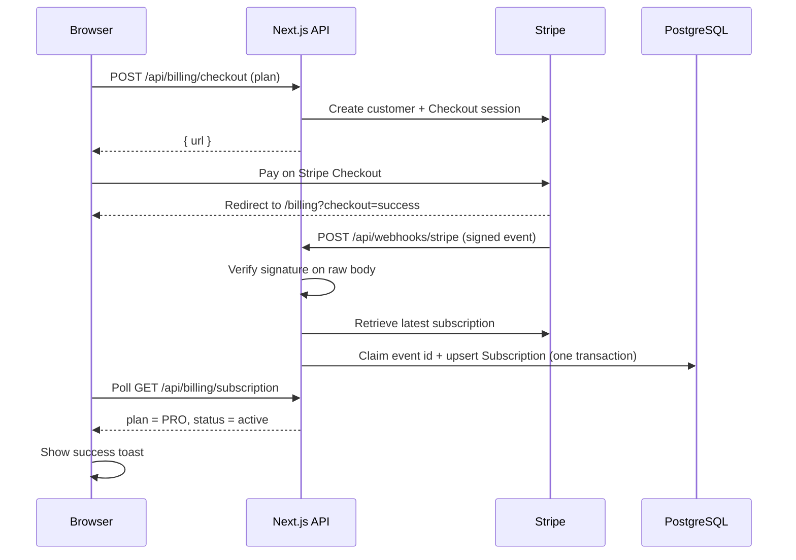
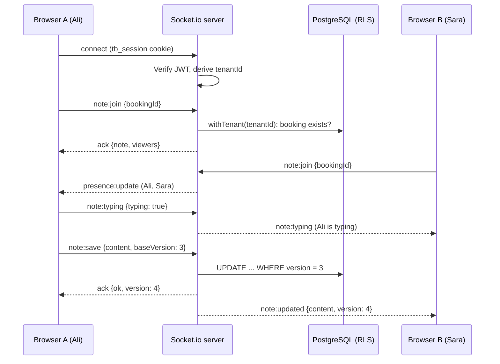
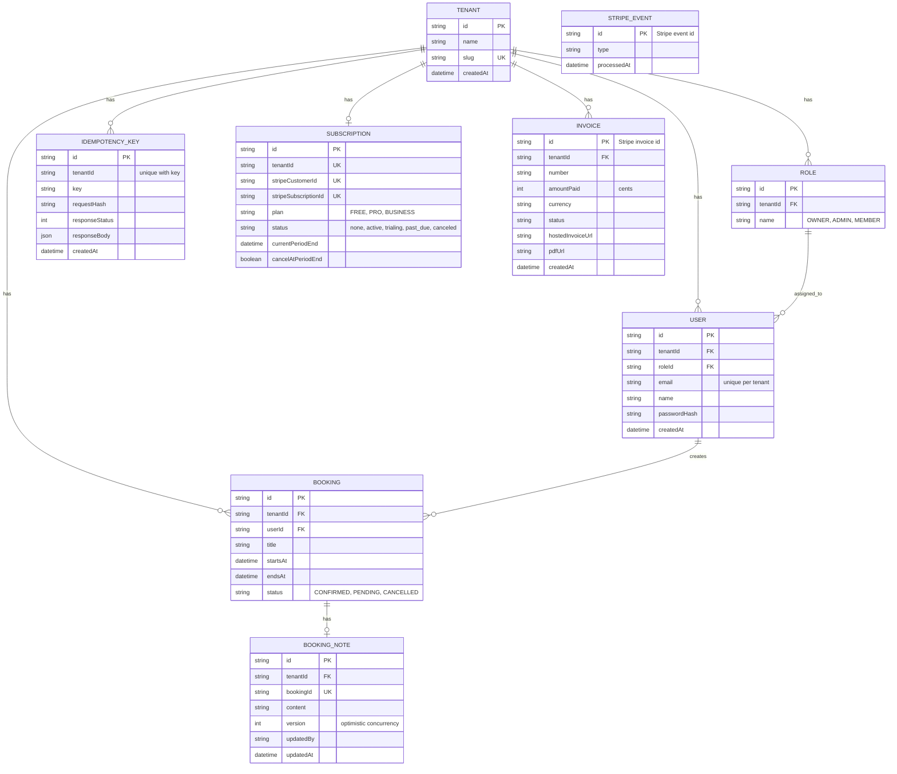
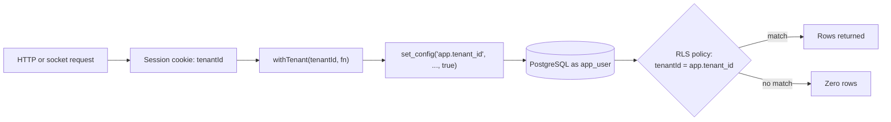

# TenantBook

A multi-tenant booking platform built with Next.js, PostgreSQL and Prisma. Every organization (tenant) gets its own isolated data, enforced at the database level with PostgreSQL Row-Level Security (RLS). Users manage bookings through idempotent REST APIs and a responsive calendar UI, pay for plans through Stripe subscriptions, and collaborate on booking notes in real time.

## What I Built

**Week 1: Foundation**
- Multi-tenant schema (Tenant, Role, User, Booking) with RLS isolation
- Dockerized PostgreSQL with separate `owner` and `app_user` roles
- Zod-validated environment variables
- Seed script with 3 realistic organizations

**Week 2: Booking APIs and UI**
- Session login with signed JWT in an `httpOnly` cookie
- Booking CRUD APIs with strict Zod validation
- **Idempotent `POST /api/bookings`** using an `Idempotency-Key` header
- One standard error response shape for every endpoint
- Role-based permissions (MEMBER edits only their own bookings)
- Calendar and list UI, create/edit form, detail view, delete with confirmation
- Toast notifications, automatic retry for network and 5xx errors, optimistic delete with rollback
- Mobile layout: month grid on desktop, agenda list on small screens
- Postman collection in `docs/`

**Week 3: Stripe subscriptions**
- Stripe Checkout for the Pro and Business plans
- Plan upgrade and downgrade with proration
- Stripe Customer Portal for payment methods and cancellation
- **Secure webhook handler** with signature verification and duplicate-event protection
- Subscription and invoice state stored per tenant and protected by RLS
- Pricing page, billing page and invoice history page
- Webhook-driven UI: polls until the webhook updates the database, then confirms with a toast

**Week 4: Real-time collaborative notes**
- Socket.io server (separate process) for live booking notes
- Presence avatars showing who is viewing a booking, one avatar per user
- Live typing indicators and a debounced auto-save status
- **Optimistic concurrency control** with a note `version`, plus a conflict-resolution banner
- Automatic reconnection with backoff, offline banner, and sync of edits made while offline
- Automated Vitest suite that drives real socket connections

## Tech Stack

- **Framework:** Next.js (App Router) + TypeScript
- **Styling:** Tailwind CSS
- **Database:** PostgreSQL 16 (Docker)
- **ORM:** Prisma 7 with `@prisma/adapter-pg`
- **Validation:** Zod (API, env vars, forms, socket payloads), React Hook Form
- **Client data:** TanStack React Query, Sonner (toasts), date-fns
- **Auth:** bcrypt password hashing, `jose` for JWT sessions
- **Payments:** Stripe (Checkout, Billing, Customer Portal, Webhooks)
- **Realtime:** Socket.io (server and client)
- **Testing:** Vitest

## Approach and Design Decisions

### 1. Tenant isolation in the database
Isolation is enforced by PostgreSQL RLS, not only by application code. Every request runs inside `withTenant(tenantId, fn)`, which opens a transaction and sets `app.tenant_id` using `set_config(..., true)`. The value is local to that transaction, so it cannot leak between requests. If no tenant is set, queries return zero rows.

Some code runs before a tenant is known (login, and Stripe webhooks, which have no session cookie). For these, `SECURITY DEFINER` functions map an identifier to a tenant ID:

- `resolve_tenant(slug)` for login
- `resolve_tenant_by_customer(stripeCustomerId)` for webhooks

### 2. Idempotent booking creation
`POST /api/bookings` requires an `Idempotency-Key` header (the client generates a UUID once per form submit).

1. The key row is inserted with `ON CONFLICT DO NOTHING` inside the same transaction as the booking.
2. **New key:** the booking is created, the response is stored on the key row, and `201` is returned.
3. **Same key, same body:** the stored response is returned with an `Idempotent-Replayed: true` header and no new booking is created.
4. **Same key, different body:** `422 IDEMPOTENCY_KEY_REUSED`.

Because the key and the booking share one transaction, two simultaneous retries cannot both create a booking. If the booking fails, the key rolls back too, so the client can retry safely. `PATCH` is naturally idempotent, and `DELETE` returns `204` even if the booking is already gone.

### 3. Standard error schema
Every endpoint returns errors in one shape, built by a single `handle()` wrapper in `src/lib/api.ts`:

```json
{
  "error": {
    "code": "VALIDATION_ERROR",
    "message": "Request validation failed",
    "details": [{ "path": "endsAt", "message": "endsAt must be after startsAt" }],
    "requestId": "b1c2..."
  }
}
```

| Code | HTTP | Meaning |
|---|---|---|
| `VALIDATION_ERROR` | 400 | Body, query or header failed validation |
| `UNAUTHORIZED` | 401 | Missing, expired or invalid session |
| `FORBIDDEN` | 403 | Role not allowed (e.g. MEMBER managing billing) |
| `NOT_FOUND` | 404 | Resource does not exist in this tenant |
| `CONFLICT` | 409 | Action conflicts with current state (e.g. already subscribed) |
| `IDEMPOTENCY_KEY_REUSED` | 422 | Same key sent with a different body |
| `INTERNAL_ERROR` | 500 | Unexpected error (details logged server-side by `requestId`) |

### 4. Frontend error handling and retry
- Field errors from `error.details` are shown inline on the form.
- Server and network errors show a toast, with a **Retry** button for 5xx and network failures.
- React Query retries only network failures and 5xx responses (up to 3 times, exponential backoff). 4xx responses are never retried.
- Retrying a create is safe because the idempotency key is reused for the same payload.
- A 401 response redirects to `/login`.
- Delete is optimistic: the row disappears immediately and is restored if the request fails.

## Billing Architecture

**Rule: the database changes only from webhooks.** The checkout redirect only brings the user back to the app. It never grants a plan. Stripe is the source of truth, and the webhook copies its state into our database.



### Plans

| Plan | Price | Booking limit |
|---|---|---|
| Free | $0 | 20 / month |
| Pro | $19 / month | 500 / month |
| Business | $49 / month | Unlimited |

Only OWNER and ADMIN users can start checkout, change plans or open the portal. MEMBER users can view billing but get `403` on changes.

### Plan changes
`POST /api/billing/change-plan` updates the Stripe subscription with proration and returns `202 Accepted`. It does **not** write the new plan to the database. The webhook does, and the UI polls until the plan matches the target.

## Webhook Security

`POST /api/webhooks/stripe` is a public endpoint, so it treats every request as untrusted until proven otherwise.

1. **Signature verification.** The raw request body (`req.text()`, never parsed JSON) is verified against the `Stripe-Signature` header using the webhook secret. Invalid or missing signatures return `400` before any other work happens.
2. **Duplicate protection.** Each Stripe event ID is inserted into the `StripeEvent` table with `ON CONFLICT DO NOTHING`. If the insert claims nothing, the event is a duplicate and the handler returns `200` with `"result":"duplicate"` without changing data.
3. **One transaction.** The event-ID insert and the state change run in the same transaction. If applying the change fails, the transaction rolls back, the event ID is not stored, and Stripe's retry is processed properly.
4. **Out-of-order events.** For subscription events, the handler fetches the latest subscription from Stripe instead of trusting the event payload.
5. **Tenant lookup without a session.** The tenant comes from Stripe metadata or from `resolve_tenant_by_customer()`. Events with no matching tenant are acknowledged and logged so Stripe does not retry forever.

Handled events: `checkout.session.completed`, `customer.subscription.created`, `customer.subscription.updated`, `customer.subscription.deleted`, `invoice.finalized`, `invoice.paid`, `invoice.payment_failed`. Other event types are acknowledged and ignored.

## Realtime Architecture

Next.js route handlers cannot hold WebSocket connections, so Socket.io runs as its own Node process (default port 4000) next to the Next.js server.



**Authentication.** No new login. The browser sends the same `tb_session` cookie to the socket server (cookies ignore ports, so use `localhost` everywhere). The server verifies the JWT with `jose`. Connections without a valid session are rejected with `UNAUTHORIZED`.

**Tenant isolation on sockets.**
- The tenant comes only from the verified JWT, never from client input.
- Rooms are named `t:{tenantId}:b:{bookingId}`, so events cannot cross organizations.
- Joining checks the booking through `withTenant`, so RLS still applies. A user from another organization gets `NOT_FOUND`.

**Testable core.** `createRealtime(httpServer, { auth, store })` takes injected authentication and storage. Production uses cookies and Prisma; tests use a token and an in-memory store, so the suite needs no database.

### Socket events

| Event | Direction | Payload | Purpose |
|---|---|---|---|
| `note:join` | client to server (ack) | `{ bookingId }` | Join the booking room; returns the note, viewers and own identity |
| `note:leave` | client to server | `{ bookingId }` | Leave the room |
| `note:typing` | client to server, then broadcast | `{ bookingId, typing }` | Typing indicator, sent to other viewers only |
| `note:save` | client to server (ack) | `{ bookingId, content, baseVersion }` | Save with a version check |
| `note:updated` | server to others | `{ bookingId, content, version, by }` | A viewer saved a new version |
| `presence:update` | server to room | `{ bookingId, users[] }` | Current viewers, one entry per user |

All payloads are validated with Zod on the server.

### Concurrency control

Each note has an integer `version`. A save sends the `baseVersion` it was based on, and the database applies the check inside the statement:

```sql
UPDATE "BookingNote"
SET "content" = $1, "version" = "version" + 1
WHERE "bookingId" = $2 AND "version" = $3
RETURNING "version"
```

If no row is returned, someone else saved first, and the server replies `CONFLICT` with the latest note. Because the check is part of the `WHERE` clause, two simultaneous saves cannot both succeed.

On a conflict, the UI shows a banner with the other person's version and two choices: **Load their version** (discard my edits) or **Keep mine** (rebase on the latest version and overwrite).

I chose optimistic concurrency over document locking because locks need timeouts and cleanup when a user disconnects, and they block other people from typing. I chose it over Yjs (CRDTs) because notes are short, and a visible conflict prompt is simpler and easier to test.

### Reconnection and offline behavior

- Socket.io reconnects automatically with exponential backoff (1 to 8 seconds).
- On every `connect`, the client re-sends `note:join`, which restores presence and fetches the latest note.
- The browser's `online` and `offline` events drive a banner: amber "Reconnecting..." or red "You're offline".
- Edits made while offline stay in the textarea. After reconnecting, if the server version is unchanged they are saved automatically; if someone else changed the note meanwhile, the conflict banner appears.
- A "Back online. Notes synced." toast confirms recovery.

## Entity Relationship Diagram



`StripeEvent` has no `tenantId` and no RLS. It stores only event IDs and is written only by the webhook route.

## Tenant Isolation Boundaries



| Boundary | Enforced by |
|---|---|
| Row visibility between tenants | PostgreSQL RLS policies on every tenant table |
| Cross-tenant writes | `WITH CHECK` clause on each policy |
| Privilege separation | `owner` (migrations, seed) vs `app_user` (runtime, `NOBYPASSRLS`) |
| Per-request scoping | `withTenant()` transaction wrapper |
| Login before tenant is known | `resolve_tenant()` `SECURITY DEFINER` function |
| Webhook before tenant is known | `resolve_tenant_by_customer()` `SECURITY DEFINER` function |
| Realtime rooms | Tenant from verified JWT, room names include the tenant ID, access checked through RLS |

## API Reference

All endpoints except login and the webhook require the session cookie. Errors use the standard shape above.

| Method | Path | Auth | Idempotent | Description |
|---|---|---|---|---|
| POST | `/api/auth/login` | No | n/a | Log in with `orgSlug`, `email`, `password`; sets cookie |
| POST | `/api/auth/logout` | Yes | Yes | Clear the session cookie |
| GET | `/api/bookings` | Yes | Yes | List bookings. Query: `from`, `to`, `status`, `page`, `pageSize` |
| POST | `/api/bookings` | Yes | Yes, via `Idempotency-Key` header (required) | Create a booking |
| GET | `/api/bookings/:id` | Yes | Yes | Get one booking |
| PATCH | `/api/bookings/:id` | Yes | Yes | Update fields. MEMBER: own bookings only |
| DELETE | `/api/bookings/:id` | Yes | Yes | Delete; returns `204` even if already deleted |
| POST | `/api/billing/checkout` | OWNER, ADMIN | Optional `Idempotency-Key` | Create a Stripe Checkout session, returns `{ url }` |
| POST | `/api/billing/change-plan` | OWNER, ADMIN | Yes (same target plan returns `409`) | Upgrade or downgrade; returns `202`, plan updates via webhook |
| POST | `/api/billing/portal` | OWNER, ADMIN | Yes | Open the Stripe Customer Portal |
| GET | `/api/billing/subscription` | Yes | Yes | Current plan and status from the database |
| GET | `/api/billing/invoices` | Yes | Yes | Invoice history from the database |
| POST | `/api/webhooks/stripe` | Stripe signature | Yes, via event-ID dedup | Receive and apply Stripe events |
| GET | `http://localhost:4000/health` | No | Yes | Realtime server health check (`ok`) |

**Create booking body**

```json
{
  "title": "Dental checkup",
  "startsAt": "2026-10-20T10:00:00Z",
  "endsAt": "2026-10-20T11:00:00Z",
  "status": "CONFIRMED"
}
```

Validation: `title` 1 to 120 characters, `endsAt` must be after `startsAt`, unknown fields are rejected.

### Postman collection

Import `docs/tenantbook.postman_collection.json` into Postman or Insomnia.

1. Set the `baseUrl` variable to `http://localhost:3000`.
2. Run the **Login** request first. It stores the session cookie.
3. Run the **Create booking** request twice with the same `Idempotency-Key` to see the replayed response.

## Screenshots

| Calendar (desktop) | Create form |
|---|---|
|  |  |

| Booking detail |
|---|
|  |


| Presence and typing indicator | Conflict banner |
|---|---|
|  |  |

| Offline banner |
|---|
|  |

## Local Setup

### Prerequisites

- Node.js 20.19+ (or 22.12+ / 24+), required by Prisma 7
- Docker Desktop
- Git
- A Stripe account in test mode and the Stripe CLI

### Steps

```bash
# 1. Install dependencies
npm install --legacy-peer-deps

# 2. Create your env file and fill in the values
cp .env.example .env

# 3. Start PostgreSQL (creates owner and app_user roles via docker/init.sql)
docker compose up -d

# 4. Apply migrations (tables, RLS policies, functions, grants)
npx prisma migrate deploy

# 5. Generate the Prisma client
npx prisma generate

# 6. Seed realistic test organizations
npx prisma db seed

# 7. Start the Next.js app and the realtime server together
npm run dev:all
```

On Windows PowerShell, use `Copy-Item .env.example .env` for step 2. Open [http://localhost:3000](http://localhost:3000).

Scripts: `npm run dev` (Next.js only), `npm run realtime` (Socket.io only), `npm run dev:all` (both), `npm test` (Vitest).

### Environment Variables

| Variable | Purpose |
|---|---|
| `DATABASE_URL` | App connection, as `app_user` (RLS enforced) |
| `DIRECT_URL` | Migrations and seed, as `owner` |
| `AUTH_SECRET` | JWT signing secret, at least 32 characters |
| `STRIPE_SECRET_KEY` | Stripe secret key (`sk_test_...`) |
| `STRIPE_WEBHOOK_SECRET` | Webhook signing secret (`whsec_...`) printed by `stripe listen` |
| `STRIPE_PRICE_PRO` | Stripe price ID of the Pro plan (`price_...`) |
| `STRIPE_PRICE_BUSINESS` | Stripe price ID of the Business plan (`price_...`) |
| `APP_URL` | Base URL used for Stripe redirects and socket CORS, e.g. `http://localhost:3000` |
| `REALTIME_PORT` | Port of the Socket.io server (default `4000`) |
| `NEXT_PUBLIC_REALTIME_URL` | Socket server URL used by the browser, e.g. `http://localhost:4000` |

Variables are validated with Zod in `src/env.ts`; the app refuses to start if any are missing or invalid. Never commit real keys: `.env` is git-ignored and `.env.example` holds placeholders only. Restart both servers after changing `.env`.

### Stripe Setup (test mode)

1. In the Stripe Dashboard (sandbox/test mode), create two products with monthly recurring prices: **Pro** ($19) and **Business** ($49). Copy each **price ID** (`price_...`, not the `prod_...` product ID) into `.env`.
2. Copy the secret key from **Developers, API keys** into `STRIPE_SECRET_KEY`.
3. Activate the **Customer portal** under **Settings, Billing, Customer portal**.
4. Install the Stripe CLI and log in:
   ```bash
   stripe login
   ```
5. With the dev server running, forward webhooks in a second terminal:
   ```bash
   stripe listen --forward-to localhost:3000/api/webhooks/stripe
   ```
   Copy the `whsec_...` it prints into `STRIPE_WEBHOOK_SECRET` and restart the dev server.

### Stripe Test Cards

| Card | Behavior |
|---|---|
| `4242 4242 4242 4242` | Payment succeeds |
| `4000 0000 0000 9995` | Declined: insufficient funds |
| `4000 0000 0000 0341` | Attaches, then fails on renewal (use with a Stripe test clock to trigger `invoice.payment_failed`) |

Use any future expiry date and any 3-digit CVC.

### Testing the webhook

```bash
# Unsigned request must be rejected with 400
curl -i -X POST http://localhost:3000/api/webhooks/stripe --data "{}"

# Resend a real event to check duplicate protection
stripe events resend evt_XXXXXXXX
```

The resent event returns `"result":"duplicate"` and the database is unchanged.

### Automated tests

```bash
npm test
```

The suite in `src/realtime/realtime.test.ts` starts a real Socket.io server on a random port with an in-memory store and connects real `socket.io-client` instances. It needs no database or Docker. It asserts:

- **Authentication:** connections without a valid session are rejected.
- **Broadcasting:** a saved note reaches other viewers but is not echoed to the sender; typing indicators reach others only.
- **State sync:** a late joiner receives the current note.
- **Presence:** viewers joining and leaving update everyone, with one avatar per user across tabs.
- **Tenant isolation:** another organization cannot join the room, save to it, or receive its events.
- **Concurrency:** a stale save returns `CONFLICT` with the latest note, a rebased save succeeds, and of two simultaneous saves exactly one wins.
- **Reconnection:** after a dropped connection the client reconnects, rejoins, and receives edits made while it was away.

### Manual realtime test

Use a normal window and an incognito window (the session cookie is shared within one browser profile). Log in as two users of `lahore-dental`, open the same booking, then:

| Test | Expected |
|---|---|
| Both open the booking | Both avatars appear in both windows |
| Type in one window | The other shows "... is typing" and the text appears live |
| Both edit at once | The second saver sees the conflict banner |
| DevTools, Network, Offline | Red offline banner; edits sync after going online |
| Stop and restart `npm run realtime` | Amber "Reconnecting..." banner, then recovery |
| Log in as `peak-fitness` and open the same booking URL | 404, no events from the other organization |

### Demo Logins

All seeded users have the password `Password123!`.

| Organization slug | Email | Role |
|---|---|---|
| `lahore-dental` | `owner@example.com` | OWNER |
| `lahore-dental` | `admin@example.com` | ADMIN |
| `lahore-dental` | `ali@example.com` | MEMBER |
| `peak-fitness` | `owner@example.com` | OWNER |
| `zenith-coworking` | `owner@example.com` | OWNER |

### Testing idempotency from the terminal

```bash
curl -i -b cookies.txt -X POST http://localhost:3000/api/bookings \
  -H "Content-Type: application/json" -H "Idempotency-Key: key-001" \
  --data '{"title":"Test","startsAt":"2026-10-20T10:00:00Z","endsAt":"2026-10-20T11:00:00Z"}'
```

Run it twice: the second response has the same booking `id` and an `Idempotent-Replayed: true` header.

## Project Structure

```
prisma/                      schema, migrations (incl. RLS), seed
docker/init.sql              creates the app_user role
vitest.config.ts             test configuration
src/env.ts                   Zod env validation
src/lib/db.ts                Prisma client and withTenant()
src/lib/api.ts               ApiError and handle() error wrapper
src/lib/session.ts           JWT session cookie
src/lib/stripe.ts            Stripe client
src/lib/plans.ts             Plan definitions and price-ID mapping
src/lib/billing.ts           React Query hooks for billing and polling
src/lib/socket.ts            Socket.io client singleton
src/lib/useBookingNote.ts    Hook: autosave, typing, presence, conflicts, reconnection
src/lib/validators/          Zod schemas
src/realtime/createRealtime.ts  Socket.io server core (injected auth and store)
src/realtime/prismaStore.ts     Prisma-backed note store with version check
src/realtime/cookieAuth.ts      JWT cookie authentication for sockets
src/realtime/server.ts          Entry point for the realtime process
src/realtime/realtime.test.ts   Multi-user broadcast and sync tests
src/app/api/                 auth, booking and billing route handlers
src/app/api/webhooks/stripe  signed webhook handler
src/app/bookings/            calendar, create, detail, edit pages
src/app/pricing/             plans page and checkout flow
src/app/billing/             current plan, portal link, invoice history
src/components/              BookingForm, BookingNotes, ConfirmDialog, StatusBadge
docs/                        Postman collection and screenshots
```

## Known Limitations

- Presence and rooms live in the memory of one realtime process. Running several instances would need the Socket.io Redis adapter.
- Notes are plain text with whole-note conflict resolution. Merging concurrent edits character by character would need a CRDT such as Yjs.
- Password reset and organization onboarding screens are not part of this scope.
- The tenant isolation test script is not yet automated against the real database.
- Stripe runs in test mode only; no live keys are configured.
- Booking limits per plan are defined in `src/lib/plans.ts`, but enforcement on `POST /api/bookings` is optional.