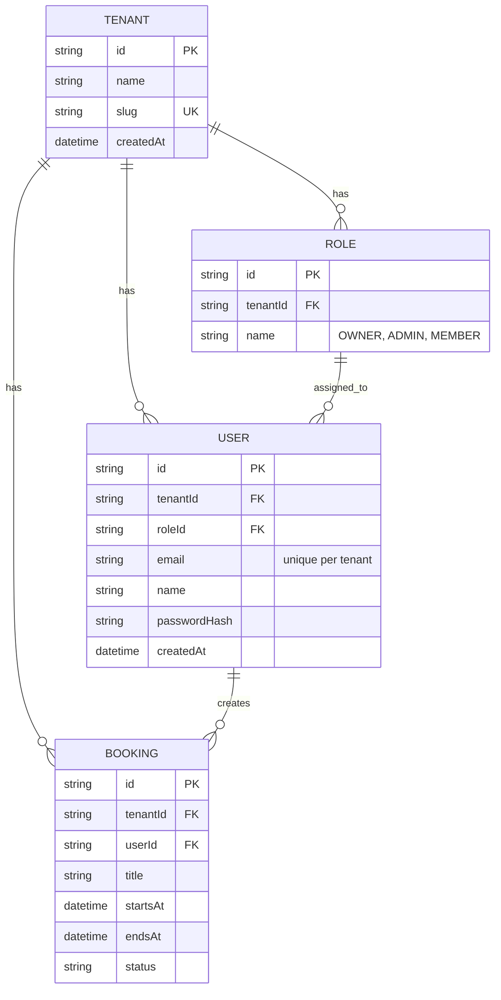
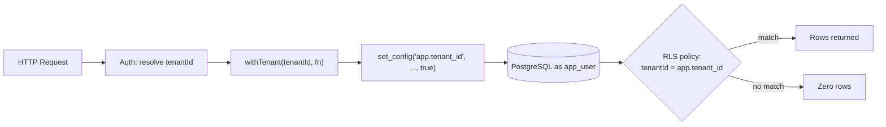

# TenantBook

A multi-tenant booking platform built with Next.js, PostgreSQL and Prisma. Every organization (tenant) gets its own isolated data, enforced at the database level with PostgreSQL Row-Level Security (RLS).

## Tech Stack

- **Framework:** Next.js (App Router) + TypeScript
- **Styling:** Tailwind CSS
- **Database:** PostgreSQL 16 (Docker)
- **ORM:** Prisma 7 with `@prisma/adapter-pg`
- **Validation:** Zod (env vars and forms), React Hook Form
- **Auth:** bcrypt password hashing

## Entity Relationship Diagram



## Tenant Isolation Boundaries

Isolation is enforced in the database, not just in application code.



**How it works**

1. **Two database roles.**
   - `owner` runs migrations and seeds. It owns the tables and bypasses RLS.
   - `app_user` is used by the running app. It is created with `NOBYPASSRLS`, so RLS always applies to it.
2. **RLS policies.** `Role`, `User`, `Booking` and `Tenant` have RLS enabled. Each policy compares the row's `tenantId` (or `id` for `Tenant`) with `current_setting('app.tenant_id', true)`.
3. **`withTenant()` helper** (`src/lib/db.ts`). It opens a transaction and sets `app.tenant_id` with `set_config(..., true)`, so the value is local to that transaction and cannot leak between requests.
4. **Fail closed.** If no tenant is set, the policy matches nothing and queries return zero rows.
5. **Composite uniqueness.** `@@unique([tenantId, email])` allows the same email address to exist in different organizations.

| Boundary | Enforced by |
|---|---|
| Row visibility between tenants | PostgreSQL RLS policies |
| Cross-tenant writes | `WITH CHECK` clause on each policy |
| Privilege separation | `owner` (migrations) vs `app_user` (runtime) |
| Per-request scoping | `withTenant()` transaction wrapper |

## Local Setup

### Prerequisites

- Node.js 20 or newer
- Docker Desktop
- Git

### Steps

```bash
# 1. Install dependencies
npm install

# 2. Create your env file and fill in the values
cp .env.example .env

# 3. Start PostgreSQL (creates the owner and app_user roles via docker/init.sql)
docker compose up -d

# 4. Generate the Prisma client
npx prisma generate

# 5. Apply migrations (includes RLS policies)
npx prisma migrate dev

# 6. Seed realistic test organizations
npx prisma db seed

# 7. Start the dev server
npm run dev
```

On Windows PowerShell, use `Copy-Item .env.example .env` for step 2.

Open [http://localhost:3000](http://localhost:3000).

### Environment Variables

| Variable | Purpose |
|---|---|
| `DATABASE_URL` | App connection, as `app_user` (RLS enforced) |
| `DIRECT_URL` | Migrations and seed, as `owner` |
| `AUTH_SECRET` | Secret for auth, at least 32 characters |

Variables are validated with Zod in `src/env.ts`. The app refuses to start if any are missing or invalid.

### Seed Data

| Organization | Slug |
|---|---|
| Lahore Dental Clinic | `lahore-dental` |
| Peak Fitness Studio | `peak-fitness` |
| Zenith Coworking | `zenith-coworking` |

Each organization has OWNER, ADMIN and MEMBER roles, several users and sample bookings.

### Verifying Isolation

Run the isolation test script (once added) to confirm that queries scoped to Tenant A return zero rows from Tenant B, and that queries with no tenant set return nothing.

## Next.js Reference

This is a [Next.js](https://nextjs.org) project bootstrapped with [`create-next-app`](https://nextjs.org/docs/app/api-reference/cli/create-next-app).

### Getting Started

First, run the development server:

```bash
npm run dev
# or
yarn dev
# or
pnpm dev
# or
bun dev
```

Open [http://localhost:3000](http://localhost:3000) with your browser to see the result.

You can start editing the page by modifying `app/page.tsx`. The page auto-updates as you edit the file.

This project uses [`next/font`](https://nextjs.org/docs/app/building-your-application/optimizing/fonts) to automatically optimize and load [Geist](https://vercel.com/font), a new font family for Vercel.

### Learn More

To learn more about Next.js, take a look at the following resources:

- [Next.js Documentation](https://nextjs.org/docs) - learn about Next.js features and API.
- [Learn Next.js](https://nextjs.org/learn) - an interactive Next.js tutorial.

You can check out [the Next.js GitHub repository](https://github.com/vercel/next.js) - your feedback and contributions are welcome!

### Deploy on Vercel

The easiest way to deploy your Next.js app is to use the [Vercel Platform](https://vercel.com/new?utm_medium=default-template&filter=next.js&utm_source=create-next-app&utm_campaign=create-next-app-readme) from the creators of Next.js.

Check out our [Next.js deployment documentation](https://nextjs.org/docs/app/building-your-application/deploying) for more details.